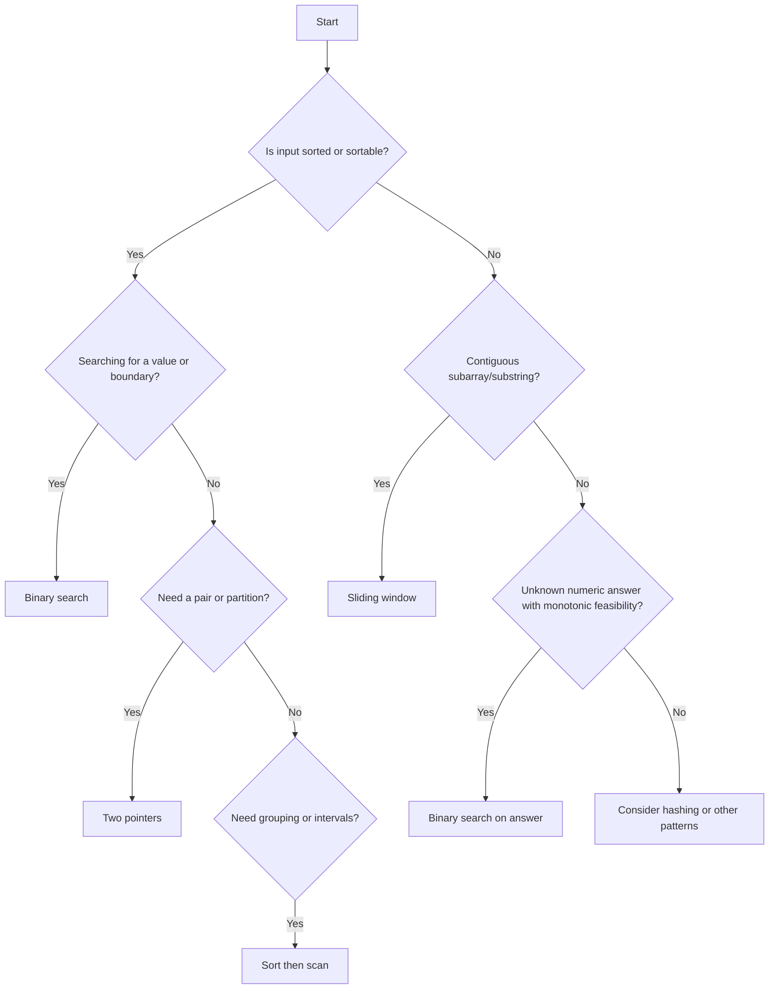

# Selecting the Right Problem-Solving Pattern

| | |
| --- | --- |
| **Week** | 2 — Two pointers, sliding window, binary search, sorting patterns |
| **Topic** | Pattern selection |
| **Estimated time** | Concepts 45 min + implementation 40 min |
| **Prerequisites** | Week 2 Days 1–5 |
| **Deliverable** | mixed problems in `problems/` attempted (sort-then-two-sum, group-anagrams, merge-intervals, find-peak-element, search-in-rotated-sorted-array, 3sum, valid-palindrome-ii, longest-repeating-character-replacement) |

## 1. Learning objectives

After this lesson you can:

1. Identify the likely pattern from a problem statement.
2. Justify the choice using input properties and constraints.
3. Distinguish two pointers, sliding window, binary search, binary search on answer, and sorting.
4. Explain why a pattern is inappropriate.
5. Solve mixed coding problems using the right pattern.

## 2. Prerequisites check

1. Can you implement all five patterns? (If no, review Days 1–5.)
2. Can you state the complexity of each? (If no, review the lessons.)
3. Have you completed Week 1? (If no, review Week 1.)

## 3. Why this matters

Choosing the right pattern is half the battle. The same problem can often be solved by multiple
patterns, but one is usually cleaner and faster. The skill is not keyword matching ("if I see
'sorted', use binary search") but verifying the input properties and correctness conditions.
This lesson teaches a decision process.

## 4. The five patterns

### 4.1 Two pointers

- **What:** two indices moving through a (usually sorted) array.
- **Suitable when:** input is sorted, or can be sorted; you need a pair or a partition.
- **Clues:** "sorted array", "pair sum", "remove duplicates in place", "container".
- **Complexity:** O(n) after sorting (O(n log n) total if sorting needed).
- **Inappropriate when:** input is unsorted and original order matters, or no monotonicity.

### 4.2 Sliding window

- **What:** a contiguous subarray/substring with a maintained aggregate or state.
- **Suitable when:** problem asks for longest/shortest contiguous subarray with a condition.
- **Clues:** "contiguous", "subarray", "substring", "longest/shortest with condition".
- **Complexity:** O(n) with O(1) or O(k) state.
- **Inappropriate when:** the subset is not contiguous, or the condition is not monotonic.

### 4.3 Binary search

- **What:** halve a sorted search space.
- **Suitable when:** input is sorted and you search for a value or boundary.
- **Clues:** "sorted array", "find index", "first/last occurrence", "insert position".
- **Complexity:** O(log n) time, O(1) space.
- **Inappropriate when:** input is unsorted, or you need all matches.

### 4.4 Binary search on answer

- **What:** search a range of possible answers using a feasibility function.
- **Suitable when:** answer is a number, feasibility is monotonic, bounds are derivable.
- **Clues:** "minimum possible maximum", "maximum possible minimum", "minimum speed/capacity".
- **Complexity:** O(n log range).
- **Inappropriate when:** feasibility is not monotonic, or bounds cannot be derived.

### 4.5 Sorting as a pattern

- **What:** sort first, then scan/group/merge.
- **Suitable when:** order enables a simpler algorithm and O(n log n) is acceptable.
- **Clues:** "group", "merge intervals", "anagrams", "closest pair".
- **Complexity:** O(n log n) + O(n).
- **Inappropriate when:** O(n) is required and O(n) space is allowed (use hashing), or
  original order must be preserved without index tracking.

## 5. Decision guide

Ask these questions in order:

1. Is the input sorted, or can sorting help without breaking requirements?
2. Is the problem asking for a contiguous subarray or substring?
3. Is the window size fixed or variable?
4. Is there a monotonic property that lets you discard half the search space?
5. Is the unknown answer a number with a monotonic feasibility function?
6. Can a pair of pointers exploit ordering?
7. What are the constraints, and which complexity is acceptable?

### Comparison table

| Pattern | Needs sorted? | Contiguous? | Monotonic? | Typical complexity |
| --- | --- | --- | --- | --- |
| Two pointers | Yes (or sort) | No | Yes (pair sum) | O(n) or O(n log n) |
| Sliding window | No | Yes | Condition-based | O(n) |
| Binary search | Yes | No | Yes (sorted) | O(log n) |
| Binary search on answer | No (answer space) | No | Feasibility monotonic | O(n log range) |
| Sorting | N/A | No | N/A | O(n log n) |

### Decision flowchart (Mermaid)

## 6. Worked examples

### Example 1 — Two pointers (simple)

Problem: given a sorted array, find if any pair sums to target. → Two pointers (O(n)).

### Example 2 — Sliding window (simple)

Problem: longest substring without repeating characters. → Variable sliding window (O(n)).

### Example 3 — Binary search (moderate)

Problem: find insertion position in a sorted array. → Binary search (O(log n)).

### Example 4 — Binary search on answer (moderate)

Problem: minimum speed to eat bananas in h hours. → Binary search on answer (O(n log max)).

### Example 5 — Sorting (moderate)

Problem: group anagrams. → Sort each word as a key (O(n k log k)).

## 7. Common misclassifications

| Misclassification | Why it fails | Correct pattern |
| --- | --- | --- |
| Using binary search on unsorted data | Wrong answer | Sort first or use hashing |
| Using sliding window for non-contiguous subset | Wrong answer | Hashing or DP |
| Using two pointers without sorted data | Wrong answer | Sort or hash |
| Using binary search on answer with non-monotonic feasibility | Wrong answer | Verify monotonicity first |
| Sorting when O(n) hashing suffices | Slower | Hashing |

## 8. Practice exercises

### Part A — Pattern identification (answers in section 10)

1. Given a sorted array, find two numbers summing to target.
2. Find the longest substring with at most K distinct characters.
3. Find the minimum capacity to ship packages in D days.
4. Find the first occurrence of a target in a sorted array.
5. Group anagrams.
6. Find the maximum sum of any contiguous subarray of size K.
7. Find the minimum eating speed for Koko.
8. Merge overlapping intervals.
9. Find the minimum size subarray with sum ≥ target.
10. Find the insertion position of a target in a sorted array.

### Part B — Mixed coding problems

See `problems/` for six mixed coding problems.

## 9. Hints

Hint 1 — for identification

Check: sorted? contiguous? monotonic? numeric answer? Then match to the table.

Hint 2 — for coding

Verify the input property before choosing the pattern. State the invariant.

## 10. Answers to pattern identification

1. Two pointers (sorted input, pair sum).
2. Sliding window (contiguous substring, variable size).
3. Binary search on answer (numeric answer, monotonic feasibility).
4. Binary search (sorted array, boundary).
5. Sorting (grouping by canonical key).
6. Sliding window (fixed size).
7. Binary search on answer (numeric answer, monotonic).
8. Sorting (sort by start, then merge).
9. Sliding window (contiguous subarray, variable size).
10. Binary search (sorted array, insertion position).

## 11. Solutions

Mixed coding problem solutions are in `exercises/solutions/` and `problems/`.

## 12. Interview applications

- **Question form:** "How do you choose between two pointers and sliding window?"
- **Expected answer shape:** "Two pointers exploit sorted order to find pairs or partitions in O(n). Sliding window maintains a contiguous subarray with a condition in O(n). I check whether the problem needs a contiguous subarray (window) or a pair in sorted data (pointers)."
- **Follow-up:** "When would you use binary search on answer?" (Answer: when the answer is a number and feasibility is monotonic.)

## 13. Review questions

Answer without looking at the lesson. If you cannot, make a flashcard.

1. State the five patterns and their key conditions.
2. What is the decision flowchart's first question?
3. Name one misclassification and why it fails.
4. How do two pointers and sliding window differ?
5. When is binary search on answer appropriate?

## 14. Related lessons

- `../two-pointers/two-pointers.md`
- `../sliding-window/sliding-window.md`
- `../binary-search/binary-search.md`
- `../binary-search-on-answer/binary-search-on-answer.md`
- `../sorting-patterns/sorting-as-a-pattern.md`
